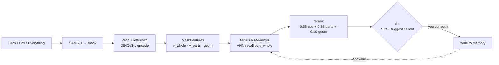

<div align="center">

# SnowLabel ❄️

**Auto-labeling that snowballs — every correction makes the next image better.**

*A progressive auto-labeling tool: click an object, teach it once, and a DINOv3 +
SAM + Milvus memory pre-fills the label for every similar object you meet next.
The model never re-trains — it just remembers.*

[]()
[]()
[]()
[]()
[]()

English | [中文](README_CN.md)

</div>

---

## 💡 Why SnowLabel

Most "AI-assisted labeling" tools hand you a **mask** but still make you click to
choose the **label**. Or they require you to define a text ontology upfront
(`"red car"`, `"yellow school bus"`, …). When the dataset is exotic, niche, or you
don't yet know all the classes, both approaches break down.

**SnowLabel learns from you, image by image.**

The first image is hard — you label it by hand. By image #10 the tool pre-fills
most labels correctly. By image #50 you mostly click *accept*. The model never
re-trains; it just **remembers** what you taught it — indexed by a powerful
self-supervised vision backbone (DINOv3), retrieved through a vector memory
(Milvus), grounded in pixel-perfect masks (SAM 2.1).

> The snowball gets bigger as you push it.

## ✨ What it does

The primary surface is a **self-contained Canvas web labeler** (no Label Studio
required) backed by one FastAPI process. Open the page, point at things, and the
memory fills up as you go.

### A web annotator with three tools

| Tool | Key | Behavior |
|------|-----|----------|
| **Point** | `p` | Left-click = positive point, right-click = negative/exclude point → live SAM mask |
| **Box** | `b` | Drag a bounding box → SAM mask |
| **Everything** | `e` | One SAM full-image pass + per-mask retrieval that labels each segment |

- **Everything mode auto-recovers misses.** Unrecognized fragments (classes the
  memory hasn't learned) are *hidden* instead of cluttering the canvas with "?".
  Click an empty spot to start a fresh mask there — full point flow (extra
  positive points to refine, right-click negatives to suppress, `Space` to accept
  it and draw the next, `C` to re-run the full pass).
- **Thin-outline rendering.** Masks are drawn as a fine contour (server-side
  `cv2.findContours`, expanded ~10 % around the centroid), one color per class,
  with the label printed at the mask centroid — far less visual noise than
  translucent fills.

### Progressive memory — "the more you label, the better it predicts"

Every committed correction is encoded and stored. The next prediction is a
**vector retrieval**, not a re-trained model:

1. **SAM 2.1** turns your click/box into a mask.
2. The mask is **crop-encoded** with DINOv3-L (crop to the mask bbox + letterbox
   to a square *without stretching* → resize → encode → mask-weighted pooling),
   producing a feature *group*: `v_whole` (semantic key), `v_parts` (a
   `parts_grid²` soft-pooled grid that keeps coarse spatial structure), and
   `geom` (area / aspect / extent / solidity).
3. **Two-stage retrieval** decides the class: stage-1 ANN recall by `v_whole`,
   then a per-candidate rerank `0.55·cos_whole + 0.35·parts_MaxSim + 0.10·geom`.
4. **Confidence tiering** sorts each prediction into **auto** (pre-applied),
   **suggest** (proposed, needs a click), or **silent** (the memory stays quiet).

Two guards keep the early curve honest:

- **Open-set gate** — if the nearest neighbor's cosine is below a floor, the query
  is "something I've never seen" and stays silent (no hallucinated labels).
- **Cold-start support gate** — a class needs a few stored examples before its
  predictions are allowed to reach the auto tier (no "1 sample ⇒ conf 1.0").

### Commit semantics — memory only grows on *teaching*

- **Add to image** (`Space`) stashes the current draft into this image (not yet
  persisted).
- **Commit image** (`Enter`) persists *only the masks the model got wrong* — ones
  you added by hand, or auto predictions whose class you changed. Predictions you
  accepted unchanged are **not** re-stored (they only feed acceptance telemetry).
  Get everything right and `Enter` just advances to the next image without
  bloating the memory.

### Plus

- **Pluggable vector backend** (`numpy` / `milvus`) behind one interface. The
  Milvus backend is a **RAM-mirror + write-through** design (read-your-own-writes
  is required for interactive labeling; milvus-lite on Windows can't serve that
  fast enough, so all reads go through an in-memory mirror while Milvus persists
  to disk). Restart-durable.
- **Three-store image cache** (`snowlabel/imgcache/`, opt-in via
  `SNOWLABEL_IMGCACHE=1`). Every uploaded image is content-addressed by SHA-256 and
  processed **once**: the image bytes go to **MinIO** (S3 object store), the SAM
  masks + metadata to **MySQL / MariaDB**, the DINOv3 vectors to **Milvus**.
  Re-open the same image and the full result is read straight back from the
  stores — no second SAM pass. A background **prefetch queue** pre-segments the
  batch so the *next* image is often already done before you click it. Infra is
  one-command (`start_infra.ps1`, no Docker); the whole thing degrades gracefully
  to "just run SAM" if the stores are unavailable.
- **Live multi-tenant demo.** `start_public_demo.ps1` puts the labeler behind a
  Cloudflare tunnel with **per-visitor isolation** — each browser gets a stable
  anonymous id (`X-Snow-User`) scoping its own uploads *and* its own snowball
  memory, so strangers can try it on their own pictures without ever touching your
  library. First-visit onboarding, one-click sample images, and a "start over"
  reset make it a self-serve trial.
- **Memory Inspector** single-page UI at `/inspector` — browse stored entries by
  class, see the distribution, search, and forget.
- **Supervision harness** (`scripts/supervise.py`) — the one gate that answers
  *"did this change make it better or worse for a real user?"*, with a human
  effort-saving north-star metric and hard quality gates.
- **Label Studio ML protocol** kept intact (`/predict`, `/webhook`,
  `/preannotate`) so SnowLabel can also serve as an LS ML backend.
- **Optional SAM 3 concept recall** — once the memory has learned a class *name*,
  a SAM 3 text prompt can recall *every* instance of it across a dataset in one
  call (`/preannotate`, `snowlabel/sam3_concept.py`).

## 📈 Does the snowball actually work?

Yes — measured end-to-end with **real SAM masks** (not ground truth), on a
125-image interleaved 5-class run:

- **86.0 % overall / 93.4 % late-half** rolling accuracy (vs ~20 % random).
- **Auto-tier predictions are ~95 % accurate** and cover ~80 % of clicks.
- The supervision harness tracks a human **effort-saving ratio** (north star)
  that the current baseline holds at roughly **0.67** while keeping late-run auto
  precision above the **≥0.97** hard gate.


Earlier phases isolated the retrieval hypothesis with GT masks: **91.5 % vs 21.8 %
baseline = +69.7 pp** ([`PHASE0_RESULTS.md`](PHASE0_RESULTS.md)); DINOv3-L lifts
that to **94.3 %** ([`PHASE1_V3_RESULTS.md`](PHASE1_V3_RESULTS.md)).

## 🏗️ How it works

One FastAPI process (`snowlabel/server.py`, port 9090) serves all three surfaces:
the Canvas labeler (`/`, `/label` → `static/labeler.html`, `/api/*`), the Memory
Inspector (`/inspector` + `/memory/*`), and the legacy Label Studio ML protocol
(`/predict`, `/webhook`, `/preannotate`). `SnowPredictor` is a single global that
wires SAM + DINO + memory together.



Deeper rationale lives in [`docs/DECISIONS.md`](docs/DECISIONS.md) (why 512+parts4,
why confidence is an absolute blended score, **why SAM stays tiny**, the
feature-space fingerprint guard, the RAM-mirror), with the front-end interaction
model in [`docs/FRONTEND.md`](docs/FRONTEND.md).

## 🚀 Quickstart

### 1. Environment

Python 3.10–3.12, an NVIDIA GPU recommended (validated on torch 2.5.1 + cu121,
RTX 4060 8 GB). Conda is the easiest path on Windows:

```powershell
conda create -n snowlabel python=3.11 -y
conda activate snowlabel
# GPU torch (replace cu121 to match your driver); omit for CPU-only
pip install torch torchvision --index-url https://download.pytorch.org/whl/cu121
```

### 2. Install dependencies

```powershell
pip install -r requirements.txt        # core (numpy / Pillow / sklearn / matplotlib …)
pip install fastapi uvicorn ultralytics transformers   # the web server + models
pip install pymilvus                   # only if you use the Milvus backend
```

> `ultralytics` auto-downloads the SAM 2.1 tiny checkpoint on first run and brings
> `cv2` (used for contours). `transformers` is needed for the DINOv3 HF backbone.

### 3. Models / weights

| What | How |
|------|-----|
| **SAM 2.1 Tiny** (click masks) | Auto-downloaded by ultralytics — nothing to do. |
| **DINOv3 ViT-L/16** (features) | Gated. Place a local HF snapshot at `weights\facebookdinov3-vitl16-pretrain-lvd1689m` and point `SNOWLABEL_DINO` at it. Without it, SnowLabel falls back to DINOv2 ViT-B/14 via torch.hub — but then **don't** set `RES=512` (see gotchas). |
| **SAM 3** (optional concept recall) | One-time `python scripts\convert_multiplex_to_hf.py` → `weights\sam3_hf\`. |

### 4. Start the server (current production config)

```powershell
$env:SNOWLABEL_DINO="weights\facebookdinov3-vitl16-pretrain-lvd1689m"
$env:SNOWLABEL_MEMORY_BACKEND="milvus"
$env:SNOWLABEL_RES="512"; $env:SNOWLABEL_PARTS_GRID="4"
python -m snowlabel.server
```

Then open:

- **http://localhost:9090/** — the Canvas labeler
- **http://localhost:9090/inspector** — the Memory Inspector

By default the labeler browses images in `demo_images/` (override with
`SNOWLABEL_DATASET_DIR`). The COCO val fallback is used if neither exists.

### 5. Label

Pick a tool (`p` / `b` / `e`), click an object, type or click its class, then
`Space` to stage and `Enter` to commit. Watch the next images start pre-filling.

| Key | Action |
|-----|--------|
| `p` / `b` / `e` | point / box / everything tool |
| left / right click | positive / negative point (point & everything-draft modes) |
| `Space` | add current draft to this image |
| `Enter` | commit this image (persists only corrections) |
| number key / click a class | relabel the selected mask |
| `C` / `Esc` | re-run everything (idle) / cancel current draft |
| `Ctrl+Shift+R` | hard-refresh after editing `labeler.html` |

> Editing `labeler.html` needs only a browser hard-refresh (FastAPI reads it from
> disk per request). Editing `web_api.py` needs a server restart.

## 🎛️ Configuration

All knobs are environment variables read by [`snowlabel/config.py`](snowlabel/config.py).
**`config.py` defaults are the source of truth** (this table mirrors them):

| Env var | Default | Meaning |
|---------|---------|---------|
| `SNOWLABEL_DINO` | `dinov2_vitb14` | DINO backbone; set to the HF snapshot path for DINOv3-L |
| `SNOWLABEL_SAM` | `sam2.1_t.pt` | SAM variant (kept **tiny** on purpose — see below) |
| `SNOWLABEL_RES` | `224` | Input resolution; use `512` for DINOv3 (patch16) |
| `SNOWLABEL_PARTS_GRID` | `4` | `v_parts` is a `N×N` soft-pooled grid |
| `SNOWLABEL_MEMORY_BACKEND` | `numpy` | `numpy` or `milvus` |
| `SNOWLABEL_CONF_AUTO` | `0.68` | auto-tier threshold on the **absolute** blended score |
| `SNOWLABEL_CONF_SUGGEST` | `0.55` | suggest-tier threshold |
| `SNOWLABEL_MARGIN_AUTO` | `0.08` | min winner-vs-runner-up gap for auto |
| `SNOWLABEL_OPEN_MIN_SIM` | `0.45` | open-set floor (below → silent) |
| `SNOWLABEL_MIN_SUPPORT_AUTO` | `3` | min stored examples before a class can auto-apply |
| `SNOWLABEL_DATASET_DIR` | `demo_images/` | folder the labeler browses |

> ⚠️ **`confidence` is an absolute blended score, not a between-class share.** The
> calibrated defaults are `0.68 / 0.55 / 0.08`. Do **not** pass the historical
> `0.85 / 0.75 / 0.61` or `0.60 / 0.58 / 0.41` values — those are an old semantic /
> calibration and will throw everything off.

## 🔬 Supervising changes

`scripts/supervise.py` is the single evaluation entry point and a **mandatory gate
before merging** any change to `features.py`, `predictor.py`, `config.py`
thresholds, the `memory*.py` retrieval path, or a SAM/DINO/resolution swap. Stop
the server on 9090 first.

```powershell
python scripts/supervise.py --quick --tag <name> --compare   # iterating  (~35s)
python scripts/supervise.py --tag <name> --compare           # pre-merge   (~75s)
python scripts/supervise.py --sweep <run_dir>                # zero-GPU threshold sweep
python scripts/supervise.py --promote <run_dir>              # set as new baseline
```

Exit codes: `0` pass / `1` hard-gate failure / `2` regression vs baseline. The
north star is a **human effort-saving ratio** (only credits the *memory* system,
not SAM's mask quality). Auto precision is a hard gate (late-run ≥ 0.97) — you may
**never** trade it away for coverage. Full protocol in
[`eval/PROTOCOL.md`](eval/PROTOCOL.md), gates in `eval/gates.json`, first findings
in [`results/supervise/FINDINGS.md`](results/supervise/FINDINGS.md).

## 🧩 Default models vs. upgrade path

| Component | Default | Validated upgrade |
|-----------|---------|-------------------|
| Mask (click) | **SAM 2.1 Tiny** (ultralytics, Apache 2.0) | **Kept tiny on purpose** — a bigger SAM gives crisper masks but pushes confusable classes (truck → car) over the auto threshold and *poisons* the memory. The supervision harness caught this; see [`docs/DECISIONS.md`](docs/DECISIONS.md) §D3. |
| Features | **DINOv2 ViT-B/14** (torch.hub) | **DINOv3 ViT-L/16** via `SNOWLABEL_DINO` (+4.4 pp overall, +13.6 pp on dog) |
| Vectors | **numpy + JSON** | **Milvus** (RAM-mirror + write-through) via `SNOWLABEL_MEMORY_BACKEND=milvus` |
| Resolution | **224²** | **512²** via `SNOWLABEL_RES=512` (DINOv3 patch16 only) |

## ⚠️ Gotchas

- **`RES=512` only works with patch16 DINOv3** (512÷16=32). The default `224` exists
  so patch14 DINOv2 doesn't crash (512÷14 isn't integer). Set `512` explicitly only
  when running DINOv3.
- **Feature-space fingerprint guard.** Changing model / resolution / parts-grid /
  crop-pad makes old vectors' cosines "computable but meaningless". Loading a
  non-empty memory whose fingerprint doesn't match **raises** on purpose — re-label
  from scratch. It's protection, not a bug.
- **Docs are bilingual** (`README.md` / `README_CN.md`, …) and may lag the code —
  when in doubt, **trust `config.py` and the code.**

## 🗺️ Roadmap

- [x] **Phase 0** — Core algorithm validation (DINO + k-NN on COCO subset)
- [x] **Phase 1** — Label Studio ML backend + SnowballMemory + end-to-end smoke
- [x] **Phase 1.5** — Threshold tuning, resolution 512 sweep, multi-prototype mode
- [x] **Phase 2** — Pluggable Milvus backend, Memory Inspector API
- [x] **Phase 3** — Canvas web labeler, everything-mode miss-recovery, thin-outline
      rendering, cold-start + open-set gates, supervision harness, end-to-end
      snowball verification (real masks)
- [x] **Phase 3.5** — 3-store image cache (MinIO + MySQL/MariaDB + Milvus) with a
      background prefetch queue; live multi-tenant public demo (Cloudflare tunnel,
      per-visitor isolation, one-click fine-grained CUB bird samples) ⬅️ *we are here*
- [ ] **Phase 4** — Screen-recording demo, non-COCO benchmark, v0.1 release

## 📄 License

[MIT](LICENSE). Note: the upstream models keep their own licenses — DINOv3 in
particular requires a `Built with DINOv3` attribution; SAM, Milvus and Label
Studio retain their respective upstream terms.

## 🙏 Built on

- [DINOv3 / DINOv2](https://github.com/facebookresearch/dinov3) by Meta AI
- [SAM 2 / SAM 3](https://github.com/facebookresearch/sam2) by Meta AI (via [ultralytics](https://github.com/ultralytics/ultralytics))
- [Milvus](https://github.com/milvus-io/milvus)
- [Label Studio](https://github.com/HumanSignal/label-studio)
- [FastAPI](https://github.com/fastapi/fastapi)
