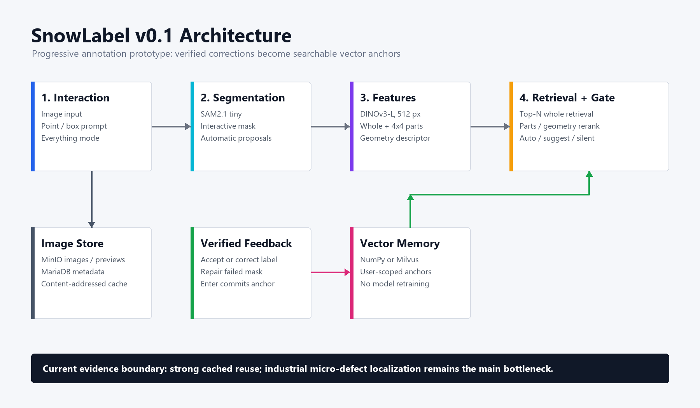

<h1 align="center">SnowLabel</h1>

<p align="center">
Progressive auto-annotation prototype with SAM, DINOv3 feature memory, and FastAPI.
</p>

<p align="center">
  
  
  
  
</p>

<p align="center">English · <a href="README_CN.md">中文</a> · <a href="https://snowlabel.zhuwenmao.com">Live demo</a></p>

## Description

SnowLabel is a progressive auto-annotation technical prototype for instance
masks. SAM proposes a mask, DINOv3 encodes the verified region, and vector
memory reuses previous corrections to classify similar regions in later images.
The models are not retrained during annotation.

The v0.1 goal is reproducible evidence for the complete feedback loop: segment,
suggest, accept or correct, store an anchor, and reuse it safely. It is not a
mature commercial annotation platform and does not yet provide a general
annotation export workflow.



## Features

- Canvas labeler with point, box, and whole-image segmentation modes.
- Progressive vector memory with user-verified anchor previews and deletion.
- Two-stage retrieval using whole-mask, 4x4 part, and geometry features.
- Confidence gates for automatic labels, suggestions, and silent rejection.
- Local numpy or Milvus memory backends and a multi-user public demo mode.
- MinIO, MariaDB, and Milvus image-processing cache for repeated Everything runs.
- FastAPI UI/API service with retained Label Studio-compatible endpoints.

**Reproducible evidence (2026-08-05)**

| Metric | COCO regression guard | VisA industrial protocol |
|---|---:|---:|
| Scope | 5 classes, 125 seen samples | 50 seen classes, 300 samples; 12 held-out classes, 48 probes |
| Late valid-mask auto precision | 100% (39 auto) | 100% (24 auto) |
| Late valid-mask auto coverage | 61.9% | 16.0% |
| Auto pollution rate | 0% | 0.33% |
| Open-set false auto | 0% | 14.58% overall; 0% among 23 valid-mask probes |
| Mask success at IoU >= 0.5 | 84.8% | 49.33% |
| Late effort saving | 66.67% | -0.33% |

The VisA result does not establish industrial readiness. It shows that accepted
auto labels remain precise when segmentation is usable, while micro-defect
localization and unknown-class suggestions remain the primary limitations. On a
1358x1104 VisA PCB image, the real `/api/segment_all` path took 69.843 seconds
uncached and 1.039 seconds cached, a 67.24x repeat-run speedup.

Machine-readable COCO and VisA results, the fixed VisA manifest, per-sample
predictions, curves, and failure visualizations are stored in
[`evidence/v0.1`](evidence/v0.1).

## How It Was Built

Most of the implementation code in this repository was written by AI coding
agents (Claude Code and Codex). My role was the part an agent cannot own:
deciding what to build, how to measure it, and which changes to accept.

- **Problem framing and metrics.** The north-star metric is human effort saved
  against a SAM-only manual baseline, so the memory loop only gets credit for
  work it actually removes. Because a wrong automatic label pollutes a dataset
  and is worse than silence, auto-label precision is a hard gate and memory
  pollution is tracked separately; coverage is never bought by loosening
  thresholds.
- **The evaluation harness is the acceptance gate.** Any change to features,
  retrieval, thresholds, memory, models, resolution, or the part grid must pass
  [`scripts/supervise.py`](scripts/supervise.py): hard gates plus a
  noise-aware regression check against a baseline
  ([`eval/PROTOCOL.md`](eval/PROTOCOL.md), [`eval/gates.json`](eval/gates.json)).
  This is how agent-written code is accepted or rejected.
- **Technical trade-offs** (reasoning and evidence in
  [`docs/DECISIONS.md`](docs/DECISIONS.md)):
  - Kept SAM 2.1 tiny instead of base. Base had a higher mIoU (~0.81), but its
    finer masks made trucks look more like cars than real cars did, pushing
    them over the auto threshold and polluting memory.
  - Redefined confidence as an absolute blend score instead of a
    class-count-dependent share, and calibrated thresholds on two open-set
    seeds with zero false auto labels.
  - Kept an in-memory mirror in front of milvus-lite, because interactive
    labeling needs read-your-writes and milvus-lite on Windows does not
    provide it reliably.
  - Store only corrections and manual additions; accepted predictions are
    logged for telemetry but never re-stored.
- **Honest reporting.** The VisA results above include the failure: accepted
  auto labels stay precise, but only about half of micro-defect masks are
  usable, so effort saving on VisA is roughly zero. The bottleneck is
  segmentation, not retrieval.
- **Product decisions and review.** Interaction model, onboarding flow, and
  sample datasets; every change was reviewed and checked in the running app.

## Prerequisites & Installation

Verified environment:

- Windows 10/11, Python 3.11, CUDA 12.1, and an NVIDIA GPU with 8 GB VRAM.
- Python 3.10+ is supported by package metadata; the published lock is the
  verified Windows/Python 3.11/CUDA 12.1 profile.
- DINOv3-L and SAM2.1 tiny weights are required for the published results.

```powershell
git clone https://github.com/zhuwenmao/snowlabel.git
cd snowlabel
pip install -r requirements.txt -c constraints/windows-py311-cu121.txt
pip install -e .[dev] -c constraints/windows-py311-cu121.txt
```

The constraints file pins the complete tested dependency tree and the CUDA 12.1
PyTorch index. A clean virtual environment can be built and verified with:

```powershell
powershell -ExecutionPolicy Bypass -File scripts/bootstrap_verified_env.ps1
```

Request access to `facebook/dinov3-vitl16-pretrain-lvd1689m` on Hugging Face,
place its snapshot under
`weights/facebookdinov3-vitl16-pretrain-lvd1689m`, and place `sam2.1_t.pt` in
the repository root. Weights are intentionally excluded from Git.

```powershell
python scripts/verify_environment.py --require-weights
```

## Quick Start / Usage

Start the local service:

```powershell
$env:SNOWLABEL_DINO="weights\facebookdinov3-vitl16-pretrain-lvd1689m"
$env:SNOWLABEL_MEMORY_BACKEND="numpy"
$env:SNOWLABEL_RES="512"
$env:SNOWLABEL_PARTS_GRID="4"
python -m snowlabel.server
```

Open `http://localhost:9090/` for the product, `/try` for the guided workflow,
or `/inspector` for memory management. The full public stack is started with:

```powershell
powershell -ExecutionPolicy Bypass -File start_public_demo.ps1
```

The launch scripts find Python via `SNOWLABEL_PYTHON`, then a conda
environment named `snowlabel`, then `python` on `PATH`.

The fixed public demo is `https://snowlabel.zhuwenmao.com`.

Reproduce the industrial evidence:

```powershell
python scripts/download_visa.py
tar -xf data/datasets/visa/VisA_20220922.tar -C data/datasets/visa
python scripts/evaluate_visa.py --tag visa-v0.1 --publish-evidence
python scripts/benchmark_everything_api.py
python scripts/supervise.py --tag coco-v0.1 --compare
```

## Repository Structure

```text
|-- snowlabel/                 # FastAPI service, models, memory, and UI
|-- eval/                      # COCO and VisA evaluation protocols
|-- scripts/                   # Setup, evaluation, smoke, and maintenance tools
|-- constraints/               # Verified Python 3.11/CUDA 12.1 dependency lock
|-- evidence/v0.1/             # Public metrics, manifests, predictions, and figures
|-- demo_images/               # Small local demonstration set
|-- docs/                      # Architecture and product decisions
|-- requirements.txt           # Supported runtime dependency ranges
|-- pyproject.toml             # Package metadata and development extras
`-- start_public_demo.ps1      # Full public demo launcher
```

## FAQ

**Is SnowLabel a production annotation platform?**

No. v0.1 is a progressive auto-annotation technical prototype. It demonstrates
and measures the memory feedback loop, but industrial micro-defect segmentation,
open-set calibration, export, access control, and operational tooling require
additional work.

**Is Label Studio required?**

No. The primary interface is SnowLabel's FastAPI and Canvas application. The
Label Studio protocol remains only for legacy integration.

**Why are weights not included?**

DINOv3 access and upstream model licenses must be handled by each user, and the
files are too large for Git. The environment verifier checks both expected
locations before evaluation.

**Why can the VisA score be worse than the COCO score?**

COCO tests five coarse object categories. VisA contains small, fine-grained
industrial defects; a point-prompted general SAM often segments the host object
instead of the defect. The published failure sheet makes this boundary explicit.

## Contributing

Pull requests are welcome. Keep changes scoped and do not commit datasets,
weights, caches, uploads, logs, or local database state. Run the checks matching
the modified area:

```powershell
python scripts/test_protocol.py
python scripts/check_feature_space_guard.py
python scripts/check_api_edges.py
python scripts/check_durability.py
python scripts/smoke_webtool.py
```

Changes to features, retrieval, thresholds, memory, models, resolution, or the
part grid must also pass:

```powershell
python scripts/supervise.py --quick --tag <name> --compare
python scripts/supervise.py --tag <name> --compare
```

## License

SnowLabel is released under the MIT License. See `LICENSE` for details.

## Acknowledgments / Citations

SnowLabel builds on Meta's SAM/SAM2 and DINOv3, FastAPI, Milvus, MinIO, and the
Label Studio ML protocol. The industrial benchmark uses Amazon's VisA dataset,
released under CC BY 4.0:

```bibtex
@article{zou2022spot,
  title={SPot-the-Difference Self-Supervised Pre-training for Anomaly Detection and Segmentation},
  author={Zou, Yang and Jeong, Jongheon and Pemula, Latha and Zhang, Dongqing and Dabeer, Onkar},
  journal={arXiv preprint arXiv:2207.14315},
  year={2022}
}
```
