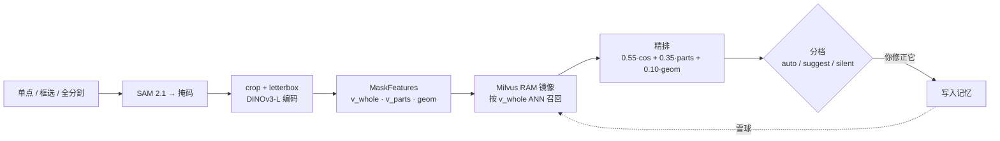

<div align="center">

# SnowLabel ❄️

**会滚雪球的自动标注 —— 每一次修正都让下一张图更准。**

*渐进式自动标注工具:点一下物体、教它一次,由 DINOv3 + SAM + Milvus 组成的记忆
就会在你之后遇到的每一个相似物体上预填标签。模型从不重训——它只是记住。*

[]()
[]()
[]()
[]()
[]()

[English](README.md) | 中文

</div>

---

## 💡 为什么是 SnowLabel

大多数"AI 辅助标注"工具给你一个**掩码(mask)**,但仍要你点选**类别**;或者要求你预先
定义一套文本本体(`"红色汽车"`、`"黄色校车"`……)。当数据集冷门、小众,或你还不知道
全部类别时,这两种方式都行不通。

**SnowLabel 一张图一张图地向你学习。**

第一张图很难——你手动标注。到第 10 张,工具已能正确预填大部分标签;到第 50 张,你
基本只需点"接受"。模型从不重训练,它只是**记住**你教过的东西:用强大的自监督视觉骨干
(DINOv3)建立索引,通过向量记忆(Milvus)检索,以像素级精确的掩码(SAM 2.1)为基础。

> 雪球越推越大。

## ✨ 功能一览

主界面是一个**自带的 Canvas 网页标注器**(不依赖 Label Studio),后端是一个 FastAPI
进程。打开页面、点击物体,记忆便随手积累。

### 三种工具的网页标注器

| 工具 | 键 | 行为 |
|------|----|------|
| **单点 point** | `p` | 左键=正点、右键=排除点(负点) → 实时 SAM 掩码 |
| **框选 box** | `b` | 拖外接框 → SAM 掩码 |
| **全分割 everything** | `e` | 一次 SAM 全图分割 + 逐掩码检索定类 |

- **everything 模式自动补漏检。** 没认出的碎块(记忆还没学过的类)会被**隐藏**,而不是
  满屏"?"干扰。点空白处即可在那里起一个新掩码——进入完整单点流程(继续加正点精修、
  右键加负点抑制、`Space` 收下并画下一个、`C` 重跑全分割)。
- **细线轮廓显示。** 掩码画成细轮廓(服务器端 `cv2.findContours`、绕质心外扩约 10%),
  每类一种颜色,label 画在掩码质心——比半透明填充干净得多。

### 渐进式记忆 ——"越标越准"

每一条提交的修正都会被编码入库。下一次预测是**向量检索**,而不是重训模型:

1. **SAM 2.1** 把你的点击/框变成掩码。
2. 用 DINOv3-L **crop-encode**(按掩码外接框 crop + letterbox 补正方形*不拉伸* →
   resize → 编码 → 软覆盖加权池化),产出一个特征*组*:`v_whole`(语义检索键)、
   `v_parts`(`parts_grid²` 软池化网格,保留粗空间结构)、`geom`(面积/长宽/extent/solidity)。
3. **两段式检索**定类:stage-1 用 `v_whole` ANN 召回,stage-2 逐候选精排
   `0.55·cos_whole + 0.35·parts_MaxSim + 0.10·geom`。
4. **置信度分档**把每条预测分进 **auto**(自动预填)、**suggest**(建议,需点一下确认)、
   **silent**(记忆保持沉默)。

两道闸门让早期曲线保持诚实:

- **开集闸门** —— 最近邻余弦低于地板时,判为"没见过的东西",保持沉默(不臆造标签)。
- **冷启动支持度门槛** —— 一个类要先攒够几个样本,它的预测才被允许进 auto 档
  (避免"1 个样本 ⇒ 置信 1.0")。

### 入库语义 —— 记忆只在"被教"时增长

- **加入本图**(`Space`)把当前 draft 暂存进本图(还没落库)。
- **入库本图**(`Enter`)只持久化*模型没做对的*掩码——你手动加的、或你改了类的 auto
  预测。识别对、没动过的预测**不重复入库**(只计入接受率遥测)。全做对时按 `Enter` 就
  直接跳下一张,不会让记忆膨胀。

### 此外

- **可插拔向量后端**(`numpy` / `milvus`),接口一致。Milvus 后端是 **RAM 镜像 + 写穿透**
  架构(交互标注必须"读己之所写";milvus-lite 在 Windows 上做不到那么快,所以读全走内存
  镜像,Milvus 只负责落盘持久化)。重启不丢。
- **三库图片缓存**(`snowlabel/imgcache/`,`SNOWLABEL_IMGCACHE=1` 开启)。每张上传图按
  SHA-256 内容寻址、**只处理一次**:图片本体进 **MinIO**(S3 对象存储),SAM 掩码 + 元数据进
  **MySQL / MariaDB**,DINOv3 向量进 **Milvus**。再次遇到同一张图,结果直接从库里读回——
  不再走第二遍 SAM。后台**预取队列**会提前把这批图分割好,常常你还没点开,下一张就已就绪。
  基础设施一键起(`start_infra.ps1`,无需 Docker);库不可用时优雅退化为"老实跑 SAM"。
- **多租户公网 Demo。** `start_public_demo.ps1` 把标注器放到 Cloudflare 隧道后,**按访客隔离**
  ——每个浏览器拿到稳定匿名 id(`X-Snow-User`),各自的上传图 *和* 雪球记忆互不干扰,陌生人
  能用自己的图试玩而绝不碰你的库。配首访引导、一键示例图、"重新开始"重置,做成自助试用。
- **Memory Inspector** 单页面板(`/inspector`)—— 按类浏览入库条目、看分布、搜索、遗忘。
- **监督程序**(`scripts/supervise.py`)—— 唯一回答"这次改动对真实用户是变好还是变坏"的
  关卡,北极星是人工省力比,外加硬质量门槛。
- **保留 Label Studio ML 协议**(`/predict`、`/webhook`、`/preannotate`),SnowLabel 也能
  当 LS ML 后端用。
- **可选的 SAM 3 概念召回** —— 记忆学到一个类**名**后,用 SAM 3 文本提示一次调用即可在整个
  数据集召回该概念的*每一个*实例(`/preannotate`、`snowlabel/sam3_concept.py`)。

## 📈 雪球真的成立吗?

成立——用**真实 SAM 掩码**(而非真值)端到端测过,125 张交错排列的 5 类图:

- **整体 86.0% / 后半段 93.4%** 滚动准确率(对比 ~20% 随机)。
- **auto 档预测约 95% 准确**,覆盖约 80% 的点击。
- 监督程序跟踪一个人工**省力比**(北极星),当前基线稳定在约 **0.67**,同时后半程 auto
  精度守住 **≥0.97** 硬门槛。


更早的阶段用真值掩码隔离了"检索"假设:**91.5% vs 21.8% 基线 = +69.7 个百分点**
([`PHASE0_RESULTS.md`](PHASE0_RESULTS.md));DINOv3-L 进一步提升到 **94.3%**
([`PHASE1_V3_RESULTS.md`](PHASE1_V3_RESULTS.md))。

## 🏗️ 工作原理

一个 FastAPI 进程(`snowlabel/server.py`,端口 9090)同时提供三个界面:Canvas 标注器
(`/`、`/label` → `static/labeler.html`、`/api/*`)、Memory Inspector(`/inspector` +
`/memory/*`)、以及旧的 Label Studio ML 协议(`/predict`、`/webhook`、`/preannotate`)。
`SnowPredictor` 是全局单例,串起 SAM + DINO + 记忆。



更深的"为什么"见 [`docs/DECISIONS.md`](docs/DECISIONS.md)(为何 512+parts4、为何置信度
是绝对混合分、**为何 SAM 保持 tiny**、特征空间指纹守卫、RAM 镜像),前端交互模型见
[`docs/FRONTEND.md`](docs/FRONTEND.md)。

## 🚀 快速开始

### 1. 环境

Python 3.10–3.12,推荐 NVIDIA GPU(在 torch 2.5.1 + cu121、RTX 4060 8GB 上验证)。
Windows 上用 conda 最省心:

```powershell
conda create -n snowlabel python=3.11 -y
conda activate snowlabel
# GPU 版 torch(把 cu121 换成你的驱动版本);纯 CPU 可跳过这行
pip install torch torchvision --index-url https://download.pytorch.org/whl/cu121
```

### 2. 安装依赖

```powershell
pip install -r requirements.txt        # 核心(numpy / Pillow / sklearn / matplotlib …)
pip install fastapi uvicorn ultralytics transformers   # 网页服务 + 模型
pip install pymilvus                   # 仅在用 Milvus 后端时需要
```

> `ultralytics` 首次运行会自动下载 SAM 2.1 tiny 权重,并带来 `cv2`(用于算轮廓)。
> `transformers` 用于 DINOv3 的 HF 骨干。

### 3. 模型 / 权重

| 是什么 | 怎么准备 |
|--------|----------|
| **SAM 2.1 Tiny**(点击掩码) | ultralytics 自动下载——无需操作。 |
| **DINOv3 ViT-L/16**(特征) | gated。把本地 HF 快照放到 `weights\facebookdinov3-vitl16-pretrain-lvd1689m`,用 `SNOWLABEL_DINO` 指向它。不设则回退到 torch.hub 的 DINOv2 ViT-B/14——但那时**别**设 `RES=512`(见"坑")。 |
| **SAM 3**(可选概念召回) | 一次性 `python scripts\convert_multiplex_to_hf.py` → `weights\sam3_hf\`。 |

### 4. 启动服务器(当前正确的生产配置)

```powershell
$env:SNOWLABEL_DINO="weights\facebookdinov3-vitl16-pretrain-lvd1689m"
$env:SNOWLABEL_MEMORY_BACKEND="milvus"
$env:SNOWLABEL_RES="512"; $env:SNOWLABEL_PARTS_GRID="4"
python -m snowlabel.server
```

然后打开:

- **http://localhost:9090/** —— Canvas 标注器
- **http://localhost:9090/inspector** —— Memory Inspector

标注器默认浏览 `demo_images/` 里的图片(用 `SNOWLABEL_DATASET_DIR` 覆盖);两者都不存在
时回退到 COCO val。

### 5. 标注

选工具(`p` / `b` / `e`)、点物体、输入或点选类别,然后 `Space` 暂存、`Enter` 入库。
看着接下来的图开始自动预填。

| 键 | 动作 |
|----|------|
| `p` / `b` / `e` | 单点 / 框选 / 全分割 工具 |
| 左键 / 右键 | 正点 / 负点(单点模式与 everything 画 draft 时) |
| `Space` | 把当前 draft 加入本图 |
| `Enter` | 入库本图(只持久化修正) |
| 数字键 / 点类别 | 给选中掩码改类 |
| `C` / `Esc` | 重跑全分割(空闲时)/ 取消当前 draft |
| `Ctrl+Shift+R` | 改完 `labeler.html` 后硬刷新 |

> 改 `labeler.html` 只需浏览器硬刷新(FastAPI 每请求从磁盘读它);改 `web_api.py` 需重启服务器。

## 🎛️ 配置

所有开关都是 [`snowlabel/config.py`](snowlabel/config.py) 读取的环境变量。
**`config.py` 默认值才是真相**(下表与之对齐):

| 环境变量 | 默认 | 含义 |
|----------|------|------|
| `SNOWLABEL_DINO` | `dinov2_vitb14` | DINO 骨干;设为 HF 快照路径即用 DINOv3-L |
| `SNOWLABEL_SAM` | `sam2.1_t.pt` | SAM 变体(**有意保持 tiny**,见下) |
| `SNOWLABEL_RES` | `224` | 输入分辨率;DINOv3(patch16)用 `512` |
| `SNOWLABEL_PARTS_GRID` | `4` | `v_parts` 是 `N×N` 软池化网格 |
| `SNOWLABEL_MEMORY_BACKEND` | `numpy` | `numpy` 或 `milvus` |
| `SNOWLABEL_CONF_AUTO` | `0.68` | auto 档阈值(作用于**绝对**混合分) |
| `SNOWLABEL_CONF_SUGGEST` | `0.55` | suggest 档阈值 |
| `SNOWLABEL_MARGIN_AUTO` | `0.08` | auto 所需的 winner 对 runner-up 最小差 |
| `SNOWLABEL_OPEN_MIN_SIM` | `0.45` | 开集地板(低于→silent) |
| `SNOWLABEL_MIN_SUPPORT_AUTO` | `3` | 一个类进 auto 档前最少入库样本数 |
| `SNOWLABEL_DATASET_DIR` | `demo_images/` | 标注器浏览的图片目录 |

> ⚠️ **`confidence` 是绝对混合分,不是类间 share。** 校准后的默认值是 `0.68 / 0.55 / 0.08`。
> **绝不能**再传历史的 `0.85 / 0.75 / 0.61` 或 `0.60 / 0.58 / 0.41`——那是旧语义/旧校准,
> 会让一切失准。

## 🔬 监督改动

`scripts/supervise.py` 是唯一评估入口,也是**合入前的强制关卡**:动了 `features.py`、
`predictor.py`、`config.py` 阈值、`memory*.py` 检索路径、或换 SAM/DINO/分辨率,合入前必须
跑并通过。跑之前先停掉 9090 服务器。

```powershell
python scripts/supervise.py --quick --tag <名字> --compare   # 迭代中(~35s)
python scripts/supervise.py --tag <名字> --compare           # 合入前正式(~75s)
python scripts/supervise.py --sweep <run_dir>                # 零 GPU 离线扫阈值
python scripts/supervise.py --promote <run_dir>              # 设为新 baseline
```

退出码:`0` 过 / `1` 硬门槛失败 / `2` 相对 baseline 回归。北极星是**人工省力比**(只把
*记忆*系统省的力算进来,不蹭 SAM 掩码质量的功劳)。auto 精度是硬门槛(后半程 ≥0.97)——
**绝不许**为覆盖率把它换掉。完整协议见 [`eval/PROTOCOL.md`](eval/PROTOCOL.md),门槛见
`eval/gates.json`,首轮结论见 [`results/supervise/FINDINGS.md`](results/supervise/FINDINGS.md)。

## 🧩 默认模型 vs. 升级路径

| 组件 | 默认 | 已验证的升级 |
|------|------|--------------|
| 掩码(点击) | **SAM 2.1 Tiny**(ultralytics,Apache 2.0) | **有意保持 tiny** —— 更大的 SAM 掩码更精细,却把易混类(truck → car)推过 auto 阈值、**污染**记忆。监督程序抓住了这点;见 [`docs/DECISIONS.md`](docs/DECISIONS.md) §D3。 |
| 特征 | **DINOv2 ViT-B/14**(torch.hub) | **DINOv3 ViT-L/16**,通过 `SNOWLABEL_DINO`(整体 +4.4pp,dog 类 +13.6pp) |
| 向量 | **numpy + JSON** | **Milvus**(RAM 镜像 + 写穿透),通过 `SNOWLABEL_MEMORY_BACKEND=milvus` |
| 分辨率 | **224²** | **512²**,通过 `SNOWLABEL_RES=512`(仅 DINOv3 patch16) |

## ⚠️ 坑(本项目特有)

- **`RES=512` 只对 patch16 的 DINOv3 成立**(512÷16=32)。默认 `224` 是为了 patch14 的
  DINOv2 不崩(512÷14 除不尽)。跑 DINOv3 时才显式设 `512`。
- **特征空间指纹守卫。** 换 模型/分辨率/分块数/crop-pad 会让旧向量的余弦"还能算但没意义"。
  加载非空、且指纹不符的旧库会**直接报错**——得清库重标。这是保护,不是 bug。
- **文档双语**(`README.md` / `README_CN.md` …)且可能落后于代码——有疑问时**以
  `config.py` 与代码为准。**

## 🗺️ 路线图

- [x] **Phase 0** —— 核心算法验证(DINO + k-NN,COCO 子集)
- [x] **Phase 1** —— Label Studio ML 后端 + SnowballMemory + 端到端冒烟
- [x] **Phase 1.5** —— 阈值调优、512 分辨率实验、多原型模式
- [x] **Phase 2** —— 可插拔 Milvus 后端、Memory Inspector API
- [x] **Phase 3** —— Canvas 网页标注器、everything 补漏检、细线轮廓显示、冷启动 + 开集闸门、
      监督程序、端到端雪球验证(真实掩码)
- [x] **Phase 3.5** —— 三库图片缓存(MinIO + MySQL/MariaDB + Milvus)+ 后台预取队列;
      多租户公网 Demo(Cloudflare 隧道、按访客隔离、一键细粒度 CUB 鸟类示例) ⬅️ *当前进度*
- [ ] **Phase 4** —— 录屏演示、非 COCO 基准、v0.1 发布

## 📄 许可证

[MIT](LICENSE)。注意:上游模型各自保留许可证——DINOv3 尤其要求标注 `Built with DINOv3`;
SAM、Milvus、Label Studio 各自遵循其上游条款。

## 🙏 基于

- [DINOv3 / DINOv2](https://github.com/facebookresearch/dinov3),Meta AI
- [SAM 2 / SAM 3](https://github.com/facebookresearch/sam2),Meta AI(经 [ultralytics](https://github.com/ultralytics/ultralytics))
- [Milvus](https://github.com/milvus-io/milvus)
- [Label Studio](https://github.com/HumanSignal/label-studio)
- [FastAPI](https://github.com/fastapi/fastapi)
